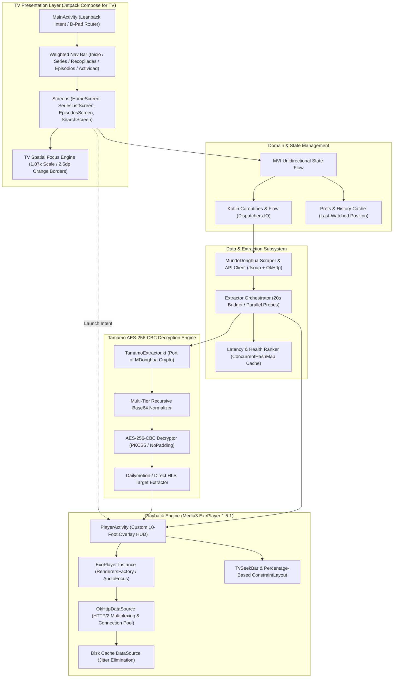
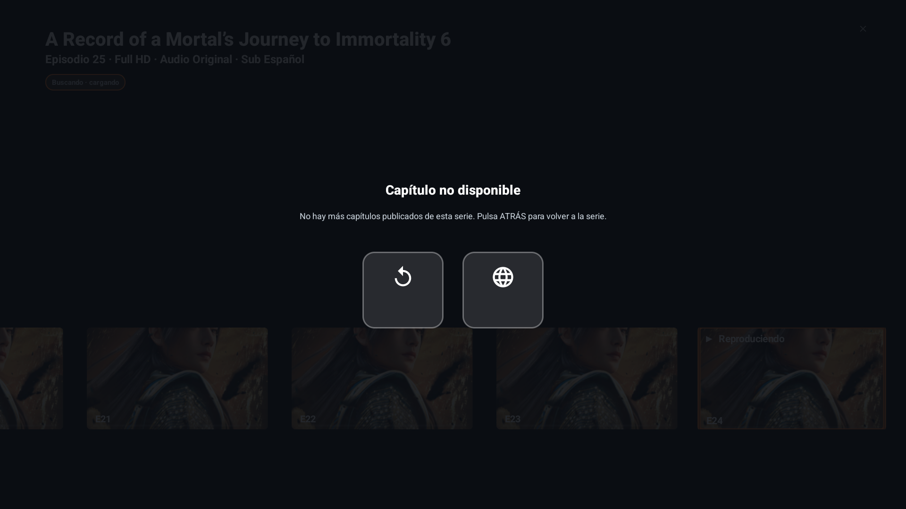

<div align="center">

# 📺 MundoDonghua TV

**A High-Performance, 10-Foot Leanback Streaming Experience for Android TV & Google TV**

[](https://developer.android.com/tv)
[](https://kotlinlang.org/)
[](https://developer.android.com/jetpack/compose/tv)
[](https://developer.android.com/media/media3)
[](https://developer.android.com)
[](LICENSE)

<br/>

<p align="center">
  
</p>

*Pixel-perfect 10-foot catalog browsing featuring 6-column spatial poster grids, dynamic category headers, and fluid D-Pad spatial navigation.*

</div>

---

## 📖 Table of Contents

- [Overview](#-overview)
- [Key Features](#-key-features)
- [Architecture & Engineering](#-architecture--engineering)
  - [High-Level System Architecture](#high-level-system-architecture)
  - [AES-256-CBC Decryption Subsystem](#aes-256-cbc-decryption-subsystem)
  - [Multi-Server Parallel Extraction Engine](#multi-server-parallel-extraction-engine)
  - [Media3 ExoPlayer & Network Pipeline](#media3-exoplayer--network-pipeline)
- [Showcase & Screenshots](#-showcase--screenshots)
- [Android TV Remote Keymap](#-android-tv-remote-keymap)
- [Tech Stack & Dependencies](#-tech-stack--dependencies)
- [Project Directory Structure](#-project-directory-structure)
- [Building & Installation](#-building--installation)
  - [Prerequisites](#prerequisites)
  - [Compiling from Source](#compiling-from-source)
  - [Sideloading via Wireless ADB](#sideloading-via-wireless-adb)
- [Configuration & Tuning](#-configuration--tuning)
- [Disclaimer & License](#-disclaimer--license)

---

## 🌟 Overview

**MundoDonghua TV** is an open-source, purpose-built Android TV client engineered specifically for viewing Chinese animation (*Donghua*) on large screens. Mobile ports and browser wrappers fail miserably on televisions—they suffer from awkward virtual-pointer controls, tiny typography, aggressive ad injections, and sluggish rendering.

MundoDonghua TV resolves this by introducing a **native, 100% remote-driven 10-foot interface** powered by **Jetpack Compose for TV** and an enterprise-grade **AndroidX Media3 ExoPlayer** video pipeline. It features:

- 🎮 **Native D-Pad Spatial Navigation**: Custom focus trees, directional hooks, and animated visual indicators (1.07x card expansion, 2.5dp orange glow borders, and circular play button badges).
- ⚡ **Multi-Server Parallel Extractor**: Simultaneously probes upstream streaming hosts (Vidhide, Swish, Fm/Bysekoze, Voe, VGembed, Asura, and Tamamo) with a 20-second budget to bypass dead links automatically.
- 🔐 **Tamamo AES-256-CBC Decryption Engine**: An on-device cryptographic recovery pipeline ported directly from browser extension sources that decrypts obfuscated video endpoints and recovers unthrottled HLS/Dailymotion streams.
- 🚀 **Zero-Stutter HLS Video Engine**: Media3 ExoPlayer backed by OkHttp connection pooling, HTTP/2 multiplexing, proactive segment caching, and resilient buffer profiles (30s minimum / 90s maximum buffer).
- 📺 **Leanback Launcher Integration**: Fully recognized Android TV banner, TV launcher intent filters, and immersive edge-to-edge system window management.

---

## ✨ Key Features

### 🎯 10-Foot Living Room UI
- **5-Destination Weighted Top Navigation**: Instant access to `Inicio` (Home), `Series`, `Recopiladas`, `Episodios`, and `Actividad` (History & Bookmarks), plus quick-action `Search` and `Settings` icons.
- **Series Sub-Bar Filtering**: Dedicated sub-navigation for `Todas`, `En Emisión`, and `Finalizadas` without cluttered multi-layer screens.
- **Anti-Drift Focus Management**: Custom TV focus-restorer implementations preserve user selection across asynchronous catalog updates and infinite-scroll pagination.
- **Dynamic 6-Column TV Grid**: Precision-calculated responsive column layouts tailored for 1080p and 4K panels with 28dp outer safety margins and 14dp card gutters.

### ⚡ Resilient Multi-Host Extraction
- **Asynchronous Parallel Probing**: Queries all candidate stream servers simultaneously rather than sequentially, finding the fastest active stream in seconds.
- **Dynamic Series Latency Cache**: Remembers previously successful servers on a per-series basis using thread-safe `ConcurrentHashMap` structures to load subsequent episodes instantly.
- **Automated Refusal & Dead-Host Filtering**: Instantly discards dead endpoints (*"video expired or deleted"*, *"embedding not allowed"*) before presenting them to the user.

### 🔐 Cryptographic Stream Recovery (Tamamo Engine)
- **Client-Side AES-256-CBC Decryption**: Decodes protected payloads returned by `/api_donghua.php?slug=...` using cryptographic keys extracted from MDonghua browser extension masking rules.
- **Recursive Base64 Unwrapping**: Automatically unwraps nested multi-tier base64 payloads (up to 3 layers) and handles both PKCS5 and zero-byte padding schemes.
- **Upstream Host Resilience**: Restores full streaming capability even when third-party intermediary players (such as `mdnemonicplayer.xyz`) go permanently offline.

### 🎬 Enterprise Media3 ExoPlayer Engine
- **Hardware-Accelerated HLS Playback**: Crystal-clear 1080p HLS playback powered by `androidx.media3:media3-exoplayer:1.5.1`.
- **HTTP/2 OkHttp Segment Pipeline**: Custom `OkHttpDataSource.Factory` with dedicated dispatcher pools prevents segment starvation on spotty Wi-Fi connections.
- **10-Foot HUD & Precision Scrubber**: Non-intrusive on-screen display with a percentage-based constraint layout, interactive episode switcher carousel, multi-server switcher modal, and audio/speed controls.
- **Last-Watched Memory**: Automatically records and resumes playback from the exact second you left off.

---

## 🏗️ Architecture & Engineering

### High-Level System Architecture



### AES-256-CBC Decryption Subsystem

Upstream providers encrypt their stream keys to prevent external playback. When third-party embedded web shells go down, standard players crash. **MundoDonghua TV** integrates the exact cryptographic reverse-engineering logic ported from the MDonghua extension:

```
Protected Slug / Base64 Payload 
    ──▶ Recursive Base64 Unwrapping (Up to 3 iterations)
    ──▶ SecretKeySpec ("64eafb71fb218e1ec0fd962f2dd12217")
    ──▶ IvParameterSpec ("c4c1dc199dc1faa5")
    ──▶ Cipher.getInstance("AES/CBC/PKCS5Padding" | "NoPadding")
    ──▶ Plaintext JSON / URL Regex Matching
    ──▶ Direct Direct HLS / Dailymotion Stream URL
```

### Multi-Server Parallel Extraction Engine

When an episode is requested, `Extractor.kt` executes asynchronous probes across all advertised providers:

| Server | Type | Extraction Technique | Fallback / Behavior |
| :--- | :--- | :--- | :--- |
| **Asura** | Native Direct | Direct redirector regex matching (`/nemonicplayer/redirector.php`) | Bypasses HTML wrapper directly into HLS |
| **Tamamo** | Native Direct | Client-side AES-256-CBC decryption (`api_donghua.php`) | Resolves hidden Dailymotion / direct HLS stream |
| **Vidhide** | Web Embed | Unpacked JavaScript packer de-obfuscation (`eval(function(p,a,c...))`) | Resolves direct `.m3u8` playlist |
| **Swish (Embedwish)** | Web Embed | HLS stream locator regex + 200 OK error-marker verification | Filters out expired/deleted video nodes |
| **Fm (Bysekoze)** | Web Embed | Upstream `/api/videos/{id}/embed/details` verification | Detects domain embedding refusal early |
| **Voe / VGembed** | Web Embed | Direct HTML extraction & HLS stream resolver | Seamless fallback candidate |

### Media3 ExoPlayer & Network Pipeline

Television Wi-Fi chips often encounter momentary bandwidth spikes. To guarantee continuous 1080p playback without dropped frames:
- **Buffer Floor**: 30,000 ms (30 seconds of video buffered before playback is considered throttled).
- **Buffer Ceiling**: 90,000 ms (90 seconds of aggressive read-ahead).
- **Start Playback Threshold**: 2,500 ms (starts video almost instantaneously upon initial touch).
- **Rebuffer Threshold**: 2,500 ms (resumes immediately after connection dips rather than waiting for 6+ seconds).

---

## 📸 Showcase & Screenshots

<div align="center">

| Catalog Navigation & TV Grid | D-Pad Spatial Focus State |
| :---: | :---: |
|  |  |
| *6-column poster grid with section headers and weighted 5-destination top bar.* | *1.07x card focus scale, 2.5dp orange outline border, and circular play badge.* |

| 10-Foot Media3 Playback HUD | Seamless Resume & Playback |
| :---: | :---: |
|  |  |
| *Percentage-scaled HUD with precision scrub bar, episode carousel, and server modal.* | *Immediate resumption from last-watched bookmark with clean video rendering.* |

</div>

---

## 🎮 Android TV Remote Keymap

Every interaction has been refined specifically for directional TV remote controls (Android TV, Google TV, Fire TV, and Smart TV remotes):

### 🏠 Main Navigation (Catalog & Details)

| Button / Key Code | Context | Action |
| :--- | :--- | :--- |
| **D-Pad Up / Down** | Catalog Screen | Navigate between top navigation tabs, sub-bars, and content rows |
| **D-Pad Left / Right** | Top Bar | Shift focus between tabs (`Inicio`, `Series`, `Recopiladas`, `Episodios`, `Actividad`) |
| **D-Pad Left / Right** | Poster Grid | Walk across cards with smooth horizontal lazy scrolling |
| **D-Pad Center / OK** | Focused Card | Open Series Detail or immediately play selected Episode |
| **D-Pad Center / OK** | Focused Tab | Activate selected category / apply filter |
| **Back Button** | Nested Screen | Return to previous view or jump back to `Inicio` tab |
| **Back Button** | Home (`Inicio`) | Exit application cleanly |
| **Voice / Mic Button** | Anywhere | Launch voice search assistant (`KEYCODE_SEARCH`, `KEYCODE_VOICE_ASSIST`) |

### 🎬 Video Player (PlayerActivity)

| Button / Key Code | HUD Visibility | Action |
| :--- | :--- | :--- |
| **D-Pad Center / OK** | Chrome Hidden | Toggle Play / Pause instantly |
| **D-Pad Center / OK** | Chrome Visible | Commit seekbar scrub or activate selected button/dialog |
| **D-Pad Left / Right** | Chrome Hidden | Quick 10-second skip backward / forward with visual preview |
| **D-Pad Left / Right** | Chrome Visible | Step precision scrubber or navigate between HUD controls |
| **D-Pad Up** | Chrome Hidden | Show HUD chrome and snap focus to precision scrub bar |
| **D-Pad Down** | Chrome Hidden | Show HUD chrome and snap focus to action buttons row |
| **D-Pad Up / Down** | Chrome Visible | Move focus between Scrub Bar, Action Buttons, and Episode Carousel |
| **Play / Pause Key** | Anywhere | Hardware media key toggle (`KEYCODE_MEDIA_PLAY_PAUSE`) |
| **Rewind / Fast-Fwd** | Anywhere | Hardware media seek (`KEYCODE_MEDIA_REWIND`, `KEYCODE_MEDIA_FAST_FORWARD`) |
| **Back Button** | Chrome Visible | **1st Press**: Dismiss HUD chrome to leave clean video playing |
| **Back Button** | Chrome Hidden | **2nd Press**: Stop playback, save bookmark position, and return to catalog |

---

## 🛠️ Tech Stack & Dependencies

| Layer | Technology | Version | Purpose |
| :--- | :--- | :--- | :--- |
| **Language** | [Kotlin](https://kotlinlang.org/) | `2.0+` | Core programming language |
| **UI Toolkit** | [Jetpack Compose for TV](https://developer.android.com/jetpack/compose/tv) | `2025.01.00 BOM` | Declarative 10-foot television user interface |
| **Design System** | [Material 3](https://developer.android.com/jetpack/compose/material3) | Compose BOM | Modern dark-themed styling, typography, and vectors |
| **Media Player** | [AndroidX Media3 ExoPlayer](https://developer.android.com/media/media3) | `1.5.1` | Core media playback, HLS stream demuxing, and rendering |
| **Network Engine** | [OkHttp](https://square.github.io/okhttp/) | `4.12.0` | Connection pooling, HTTP/2 multiplexing, and cookie jars |
| **HTML Parser** | [Jsoup](https://jsoup.org/) | `1.18.1` | Server catalog parsing and dynamic DOM extraction |
| **Image Loading** | [Coil](https://coil-kt.github.io/coil/) | `2.7.0` | High-performance asynchronous image caching for posters |
| **Layouts** | [ConstraintLayout](https://developer.android.com/reference/androidx/constraintlayout/widget/ConstraintLayout) | `2.2.1` | Density-independent HUD percentage constraint layout |
| **Compatibility** | [Desugar JDK](https://developer.android.com/studio/write/java8-support) | `2.1.4` | Java 17+ APIs backported to Android 5.0 (API 21) |

---

## 📂 Project Directory Structure

```
MundoDonghuaTV/
├── app/
│   ├── build.gradle.kts                # Application build definitions & Media3/Compose dependencies
│   ├── proguard-rules.pro              # ProGuard / R8 optimization configuration
│   └── src/main/
│       ├── AndroidManifest.xml         # Leanback TV launcher declarations & permissions
│       ├── assets/mdonghua/            # MDonghua cryptographic masks & ruleset references
│       ├── java/com/donghua/tv/
│       │   ├── App.kt                  # Application initialization & Coil cache setup
│       │   ├── Focus.kt                # Spatial TV focus helpers & modifier extensions
│       │   ├── MainActivity.kt         # Compose TV host, navigation state & D-Pad event dispatcher
│       │   ├── data/
│       │   │   ├── Api.kt              # HTTP endpoints, search queries & session management
│       │   │   ├── Extractor.kt        # Multi-server parallel probing & timeout orchestration
│       │   │   ├── Models.kt           # Data classes (MediaCard, Episode, ServerItem, SeriesDetail)
│       │   │   ├── Parser.kt           # Jsoup catalog and series scrapers
│       │   │   ├── Prefs.kt            # Persistent history, favorites & playback resume storage
│       │   │   └── TamamoExtractor.kt  # AES-256-CBC decryption engine & base64 unwrap logic
│       │   ├── player/
│       │   │   ├── EpisodeCardView.kt  # TV-focused episode card component in HUD
│       │   │   ├── PlaybackEngine.kt   # ExoPlayer lifecycle, audio focus & load control configuration
│       │   │   ├── PlayerActivity.kt   # TV video player, remote key handlers & HUD dialogs
│       │   │   ├── StreamPrefetcher.kt # Speculative stream caching & pre-buffering
│       │   │   ├── TvMetrics.kt        # Display resolution & aspect ratio helpers
│       │   │   └── TvSeekBar.kt        # D-Pad driven scrub bar with preview indicators
│       │   └── ui/
│       │       ├── ActivityScreen.kt   # History, favorites, and pending watchlists
│       │       ├── Components.kt       # Reusable TV cards, focus borders & circular badges
│       │       ├── DetailScreen.kt     # Series synopsis, metadata & episode selection grid
│       │       ├── EpisodesScreen.kt   # Dedicated latest episode browsing view
│       │       ├── HomeScreen.kt       # Featured carousel & dynamic section rows
│       │       ├── Layout.kt           # TV layout scaffolding, spacing & focus bounds
│       │       ├── SearchScreen.kt     # On-screen keyboard & voice search results grid
│       │       ├── SeriesListScreen.kt # Filtered series catalog (Todas, En Emisión, Finalizadas)
│       │       ├── SettingsScreen.kt   # Playback speed, buffering & server preferences
│       │       └── Theme.kt            # Donghua orange theme (`#F47521`), colors, and shapes
│       └── res/                        # Vector drawables, TV banner, icons, and layout XMLs
├── docs/
│   └── screenshots/                    # High-definition 10-foot UI screenshots for showcase
├── keystore/
│   └── donghua.jks                     # Production release keystore
├── build.gradle.kts                    # Root project build configuration
├── gradle.properties                   # JVM args & AndroidX flags
└── settings.gradle.kts                 # Project modules & repository definitions
```

---

## 🚀 Building & Installation

### Prerequisites

- **Java Development Kit (JDK)**: Version 17 or newer.
- **Android SDK**: Platform SDK 36 (Build Tools 36.0.0+).
- **Target Device**: Android TV, Google TV, or Fire TV device with **Developer Options** and **ADB Debugging** enabled.

### Compiling from Source

1. Clone the repository:
   ```bash
   git clone https://github.com/Dreftian/MundoDonghuaTV.git
   cd MundoDonghuaTV
   ```

2. Build the optimized release APK using Gradle:
   ```bash
   # On Linux / macOS:
   ./gradlew assembleRelease

   # On Windows PowerShell:
   .\gradlew.bat assembleRelease
   ```

3. The signed APK will be generated at:
   ```
   app/build/outputs/apk/release/app-release.apk
   ```

### Sideloading via Wireless ADB

Connect directly to your Smart TV or TV box over your local Wi-Fi network:

```bash
# 1. Connect to the TV (substitute with your TV's local IP address)
adb connect 192.168.18.22:5555

# 2. Verify device connection
adb devices

# 3. Sideload the release APK
adb -s 192.168.18.22:5555 install -r app/build/outputs/apk/release/app-release.apk

# 4. Launch MundoDonghua TV directly onto the screen
adb -s 192.168.18.22:5555 shell am start -n com.donghua.tv/.MainActivity
```

---

## ⚙️ Configuration & Tuning

### Buffering & Network Tuning
Buffer parameters in `app/src/main/java/com/donghua/tv/player/PlayerActivity.kt` can be adjusted to match challenging network environments:

```kotlin
// Buffer configuration (milliseconds)
private const val MIN_BUFFER_MS = 30_000           // Pre-buffered window before throttling
private const val MAX_BUFFER_MS = 90_000           // Upper buffer ceiling
private const val BUFFER_FOR_PLAYBACK_MS = 2_500   // Instant playback start floor
```

### Extraction Timeouts
Server probing limits can be tuned in `app/src/main/java/com/donghua/tv/data/Extractor.kt`:

```kotlin
private const val EMBED_PROBE_BUDGET_MS = 20_000L  // Total wall-clock time allowed for probes
private const val PROBE_TIMEOUT_SECONDS = 12L      // Individual connect timeout per host
```

---

## ⚖️ Disclaimer & License

### Disclaimer
This software is developed strictly for **educational and interoperability research purposes**. MundoDonghua TV does not host, upload, or store any media files or streams on its own servers. All content is indexed dynamically from publicly accessible third-party providers. All intellectual property, trademarks, and media assets belong to their respective copyright holders.

### License
This project is licensed under the **Apache License, Version 2.0**. See the [LICENSE](LICENSE) file for full details.

```
Copyright 2026 MundoDonghuaTV Contributors

Licensed under the Apache License, Version 2.0 (the "License");
you may not use this file except in compliance with the License.
You may obtain a copy of the License at

    http://www.apache.org/licenses/LICENSE-2.0

Unless required by applicable law or agreed to in writing, software
distributed under the License is distributed on an "AS IS" BASIS,
WITHOUT WARRANTIES OR CONDITIONS OF ANY KIND, either express or implied.
See the License for the specific language governing permissions and
limitations under the License.
```

---

<div align="center">
  <sub>Crafted with passion for Chinese animation enthusiasts and the Android TV community.</sub>
</div>
