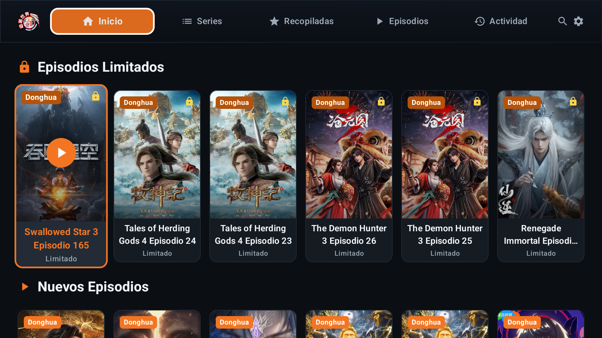
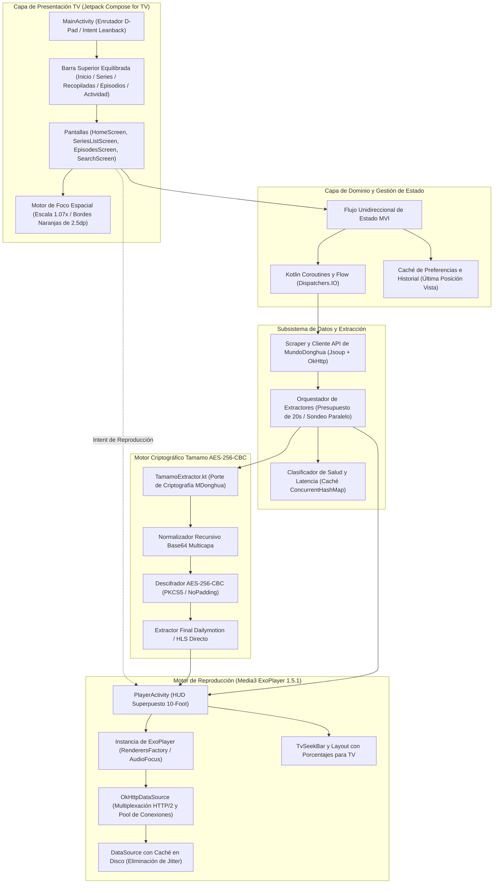
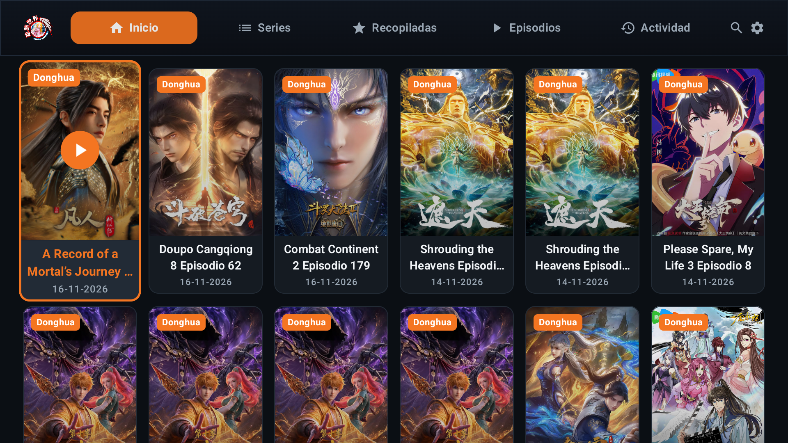

<div align="center">

# 📺 MundoDonghua TV

**Una experiencia de streaming nativa de alto rendimiento en formato 10-Foot (Leanback) para Android TV y Google TV**

[](https://developer.android.com/tv)
[](https://kotlinlang.org/)
[](https://developer.android.com/jetpack/compose/tv)
[](https://developer.android.com/media/media3)
[](https://developer.android.com)
[](LICENSE)

<br/>

<p align="center">
  
</p>

*Navegación espacial de catálogo optimizada para televisores con cuadrículas de 6 columnas, encabezados dinámicos por categoría y control 100% fluido mediante D-Pad.*

</div>

---

## 📖 Tabla de Contenidos

- [Descripción General](#-descripción-general)
- [Características Principales](#-características-principales)
- [Arquitectura e Ingeniería](#-arquitectura-e-ingeniería)
  - [Arquitectura de Alto Nivel del Sistema](#arquitectura-de-alto-nivel-del-sistema)
  - [Subsistema Criptográfico AES-256-CBC](#subsistema-criptográfico-aes-256-cbc)
  - [Motor de Extracción Paralelo Multiservidor](#motor-de-extracción-paralelo-multiservidor)
  - [Pipeline de Red y Media3 ExoPlayer](#pipeline-de-red-y-media3-exoplayer)
- [Galería de Capturas de Pantalla](#-galería-de-capturas-de-pantalla)
- [Mapeo de Control Remoto de Android TV](#-mapeo-de-control-remoto-de-android-tv)
- [Stack Tecnológico y Dependencias](#-stack-tecnológico-y-dependencias)
- [Estructura del Proyecto](#-estructura-del-proyecto)
- [Compilación e Instalación](#-compilación-e-instalación)
  - [Requisitos Previos](#requisitos-previos)
  - [Compilar desde el Código Fuente](#compilar-desde-el-código-fuente)
  - [Instalación Inalámbrica mediante ADB](#instalación-inalámbrica-mediante-adb)
- [Configuración y Ajustes](#-configuración-y-ajustes)
- [Descargo de Responsabilidad y Licencia](#-descargo-de-responsabilidad-y-licencia)

---

## 🌟 Descripción General

**MundoDonghua TV** es un cliente nativo y de código abierto diseñado desde cero para disfrutar de la animación china (*Donghua*) en pantallas grandes de televisión. Las adaptaciones de aplicaciones móviles o visores web convencionales fallan drásticamente en Smart TVs: presentan controles incómodos de cursor virtual, textos diminutos, publicidad invasiva y caídas severas de rendimiento.

MundoDonghua TV resuelve estas deficiencias ofreciendo una **interfaz nativa para salas de estar (10-Foot UI)**, controlada al 100% mediante el control remoto, construida sobre **Jetpack Compose for TV** y respaldada por un motor de video de grado industrial basado en **AndroidX Media3 ExoPlayer**. Destaca por:

- 🎮 **Navegación Espacial Nativa con D-Pad**: Árboles de foco personalizados, indicadores animados (crecimiento del 1.07x al enfocar tarjetas, borde naranja con resplandor de 2.5dp y botón circular central de reproducción).
- ⚡ **Extractor Paralelo Multiservidor**: Realiza peticiones simultáneas a múltiples proveedores de streaming (Vidhide, Swish, Fm/Bysekoze, Voe, VGembed, Asura y Tamamo) con un límite de tiempo de 20 segundos para descartar enlaces caídos de forma automática.
- 🔐 **Motor de Desencriptación Tamamo AES-256-CBC**: Subsistema criptográfico en el dispositivo adaptado directamente de la extensión de navegador MDonghua, capaz de descifrar endpoints protegidos y recuperar transmisiones directas de HLS/Dailymotion sin restricciones.
- 🚀 **Reproducción HLS sin Cortes**: Media3 ExoPlayer optimizado con grupos de conexión en OkHttp, multiplexación HTTP/2, almacenamiento preventivo en búfer y umbrales tolerantes (mínimo de 30 segundos / máximo de 90 segundos).
- 📺 **Integración Completa con Android TV**: Banner oficial de Leanback TV, filtros de intent para lanzadores de Smart TV y manejo inmersivo de bordes de pantalla (*Edge-to-Edge*).

---

## ✨ Características Principales

### 🎯 Interfaz 10-Foot para la Sala de Estar
- **Barra de Navegación Superior Equilibrada (5 Secciones)**: Acceso inmediato a `Inicio`, `Series`, `Recopiladas`, `Episodios` y `Actividad` (Historial y Favoritos), junto con accesos directos a `Búsqueda` y `Ajustes`.
- **Filtros Rápidos para Series**: Sub-barra dedicada para clasificar instantáneamente entre `Todas`, `En Emisión` y `Finalizadas`.
- **Control de Foco sin Pérdida de Posición**: Gestión inteligente del foco que preserva la selección del usuario frente a recargas asíncronas de contenido o desplazamiento infinito.
- **Cuadrícula Dinámica de 6 Columnas**: Diseño geométrico milimétricamente calculado para resoluciones 1080p y 4K con márgenes exteriores seguros de 28dp y separaciones de 14dp entre tarjetas.

### ⚡ Extracción Resistente Multiservidor
- **Sondeo Asíncrono en Paralelo**: En lugar de consultar un servidor a la vez, consulta todos los servidores candidatos al mismo tiempo, entregando la transmisión activa más veloz en cuestión de segundos.
- **Caché Inteligente de Latencia por Serie**: Almacena en memoria (`ConcurrentHashMap`) los servidores exitosos para cada serie, haciendo que los siguientes episodios arranquen de inmediato.
- **Detección y Descarte de Enlaces Caídos**: Filtra automáticamente servidores con videos borrados, permisos denegados o dominios inaccesibles antes de mostrárselos al usuario.

### 🔐 Recuperación Criptográfica de Transmisiones (Motor Tamamo)
- **Desencriptación AES-256-CBC en el Cliente**: Decodifica las cargas útiles entregadas por `/api_donghua.php?slug=...` usando las claves reales extraídas de las reglas de ofuscación de la extensión MDonghua.
- **Desenvolvimiento Recursivo Base64**: Desenrolla hasta 3 capas anidadas de Base64, admitiendo esquemas de relleno PKCS5 y padding de bytes nulos.
- **Resiliencia ante Caídas Externas**: Restaura la reproducción incluso cuando reproductores intermediarios de terceros (como `mdnemonicplayer.xyz`) quedan permanentemente fuera de servicio.

### 🎬 Motor de Reproducción Media3 ExoPlayer
- **Aceleración por Hardware para HLS**: Reproducción Full HD 1080p fluida impulsada por `androidx.media3:media3-exoplayer:1.5.1`.
- **Pipeline de Red OkHttp con HTTP/2**: Fábrica personalizada de origen de datos con balanceo de hilos que evita la falta de paquetes ante señales Wi-Fi inestables.
- **Controles HUD en Pantalla Adaptados para TV**: Menú superpuesto no invasivo con barra de salto temporal milimétrica, selector horizontal de episodios tipo carrusel, diálogo de cambio de servidores y ajuste de velocidad.
- **Memoria de Última Posición Vista**: Guarda automáticamente el segundo exacto donde te quedaste para reanudar la reproducción cuando vuelvas.

---

## 🏗️ Arquitectura e Ingeniería

### Arquitectura de Alto Nivel del Sistema



---

### Subsistema Criptográfico AES-256-CBC

Varios proveedores protegen sus enlaces de video para impedir la reproducción fuera de sus sitios web. Cuando sus reproductores web fallan, las aplicaciones convencionales dejan de funcionar. **MundoDonghua TV** integra la lógica criptográfica extraída y adaptada de la extensión MDonghua:

```
Identificador Protegido / Carga Útil en Base64
    ──▶ Desenrollado Recursivo en Base64 (Hasta 3 niveles)
    ──▶ Clave Secreta ("64eafb71fb218e1ec0fd962f2dd12217")
    ──▶ Vector de Inicialización IV ("c4c1dc199dc1faa5")
    ──▶ Cipher.getInstance("AES/CBC/PKCS5Padding" | "NoPadding")
    ──▶ Extracción de JSON en Texto Claro / Expresiones Regulares
    ──▶ Enlace Directo a Playlist HLS / Transmisión Dailymotion
```

---

### Motor de Extracción Paralelo Multiservidor

Cuando se selecciona un capítulo, `Extractor.kt` lanza sondeos asíncronos y simultáneos a través de todos los servidores disponibles:

| Servidor | Tipo | Técnica de Extracción | Comportamiento / Contingencia |
| :--- | :--- | :--- | :--- |
| **Asura** | Directo Nativo | Detección de redirección por Regex (`/nemonicplayer/redirector.php`) | Salta el envoltorio web y extrae el HLS directo |
| **Tamamo** | Directo Nativo | Desencriptación AES-256-CBC en cliente (`api_donghua.php`) | Resuelve la transmisión oculta de Dailymotion / HLS |
| **Vidhide** | Web Embed | Desempaquetado de JavaScript ofuscado (`eval(function(p,a,c...))`) | Obtiene la lista de reproducción `.m3u8` directa |
| **Swish (Embedwish)** | Web Embed | Localizador Regex HLS con validación de código HTTP 200 | Filtra y descarta enlaces con videos borrados o expirados |
| **Fm (Bysekoze)** | Web Embed | Verificación contra `/api/videos/{id}/embed/details` | Detecta anticipadamente bloqueos de inserción de dominio |
| **Voe / VGembed** | Web Embed | Extracción directa sobre el DOM HTML y resolución HLS | Excelente servidor de respaldo alternativo |

---

### Pipeline de Red y Media3 ExoPlayer

Las conexiones Wi-Fi en televisores suelen experimentar fluctuaciones momentáneas. Para garantizar una reproducción en 1080p sin congelamientos ni caídas de fotogramas:
- **Búfer Mínimo (Piso)**: 30,000 ms (almacena 30 segundos continuos antes de considerar baja velocidad).
- **Búfer Máximo (Techo)**: 90,000 ms (hasta 90 segundos de lectura anticipada de fragmentos).
- **Arranque Instantáneo**: 2,500 ms (inicia la reproducción de video casi al instante al presionar reproducir).
- **Reanudación tras Caída de Red**: 2,500 ms (reanuda inmediatamente sin obligar al usuario a esperar recargas prolongadas).

---

## 📸 Galería de Capturas de Pantalla

<div align="center">

| Navegación de Catálogo en TV | Indicador de Foco Espacial con D-Pad |
| :---: | :---: |
|  |  |
| *Cuadrícula de 6 columnas con encabezados por sección y barra superior distribuida en 5 pestañas.* | *Efecto de foco con escala 1.07x, borde naranja de 2.5dp y botón circular central de reproducción.* |

| Controles HUD del Reproductor Media3 | Reanudación Inmediata de Reproducción |
| :---: | :---: |
|  |  |
| *Controles adaptados para TV con barra de búsqueda milimétrica, selector de episodios y cambio de servidor.* | *Reanudación automática desde el último punto visto con imagen en alta definición.* |

</div>

---

## 🎮 Mapeo de Control Remoto de Android TV

Cada interacción de la aplicación ha sido optimizada para los controles remotos direccionales de televisores (Android TV, Google TV, Fire TV y TV Boxes):

### 🏠 Navegación Principal (Catálogo y Detalles)

| Botón / Código de Tecla | Contexto | Acción |
| :--- | :--- | :--- |
| **D-Pad Arriba / Abajo** | Catálogo Principal | Cambia el foco entre la barra superior, sub-filtros y filas de contenido |
| **D-Pad Izquierda / Derecha** | Barra Superior | Alterna entre pestañas (`Inicio`, `Series`, `Recopiladas`, `Episodios`, `Actividad`) |
| **D-Pad Izquierda / Derecha** | Grilla de Series | Navega lateralmente a través de las tarjetas con desplazamiento fluido |
| **D-Pad Centro / OK** | Tarjeta Enfocada | Abre la ficha detallada de la serie o reproduce el episodio seleccionado |
| **D-Pad Centro / OK** | Pestaña Enfocada | Activa la sección seleccionada o aplica el filtro correspondiente |
| **Botón Atrás (Back)** | Pantalla Secundaria | Regresa a la vista anterior o salta directamente a la pestaña `Inicio` |
| **Botón Atrás (Back)** | En `Inicio` | Sale limpiamente de la aplicación |
| **Botón de Micrófono / Voz** | En cualquier lugar | Activa la búsqueda por voz (`KEYCODE_SEARCH`, `KEYCODE_VOICE_ASSIST`) |

### 🎬 Reproductor de Video (PlayerActivity)

| Botón / Código de Tecla | Estado de Controles (HUD) | Acción |
| :--- | :--- | :--- |
| **D-Pad Centro / OK** | Controles Ocultos | Pausa o Reanuda el video inmediatamente |
| **D-Pad Centro / OK** | Controles Visibles | Aplica el salto en la barra de tiempo o acciona el botón seleccionado |
| **D-Pad Izquierda / Derecha** | Controles Ocultos | Salto rápido de 10 segundos hacia atrás o adelante con indicador en pantalla |
| **D-Pad Izquierda / Derecha** | Controles Visibles | Mueve la barra de tiempo con precisión o navega por los botones del menú |
| **D-Pad Arriba** | Controles Ocultos | Muestra los controles y coloca el foco en la barra de tiempo |
| **D-Pad Abajo** | Controles Ocultos | Muestra los controles y coloca el foco en la fila de botones de acción |
| **D-Pad Arriba / Abajo** | Controles Visibles | Cambia el foco entre la barra de tiempo, botones y carrusel de capítulos |
| **Tecla Play / Pause** | En cualquier momento | Control directo por botón físico (`KEYCODE_MEDIA_PLAY_PAUSE`) |
| **Rebobinar / Adelantar** | En cualquier momento | Avance o retroceso multimedia (`KEYCODE_MEDIA_REWIND`, `KEYCODE_MEDIA_FAST_FORWARD`) |
| **Botón Atrás (Back)** | Controles Visibles | **1er Toque**: Oculta los controles y continúa reproduciendo a pantalla limpia |
| **Botón Atrás (Back)** | Controles Ocultos | **2do Toque**: Detiene el video, guarda la posición en el historial y vuelve al menú |

---

## 🛠️ Stack Tecnológico y Dependencias

| Capa | Tecnología | Versión | Propósito |
| :--- | :--- | :--- | :--- |
| **Lenguaje** | [Kotlin](https://kotlinlang.org/) | `2.0+` | Lenguaje de programación principal |
| **Framework de UI** | [Jetpack Compose for TV](https://developer.android.com/jetpack/compose/tv) | `2025.01.00 BOM` | Interfaz declarativa optimizada para formato 10-foot |
| **Sistema de Diseño** | [Material 3](https://developer.android.com/jetpack/compose/material3) | Compose BOM | Estilo oscuro moderno, componentes y tipografías |
| **Reproductor de Video** | [AndroidX Media3 ExoPlayer](https://developer.android.com/media/media3) | `1.5.1` | Motor de reproducción, renderizado y desencapsulado HLS |
| **Cliente de Red** | [OkHttp](https://square.github.io/okhttp/) | `4.12.0` | Multiplexación HTTP/2, conexión agrupada y control de cookies |
| **Parseador HTML** | [Jsoup](https://jsoup.org/) | `1.18.1` | Análisis y extracción del catálogo y contenido web |
| **Carga de Imágenes** | [Coil](https://coil-kt.github.io/coil/) | `2.7.0` | Carga asíncrona y almacenamiento en caché de imágenes |
| **Diseño Flexible** | [ConstraintLayout](https://developer.android.com/reference/androidx/constraintlayout/widget/ConstraintLayout) | `2.2.1` | Diseño proporcional por porcentajes para controles HUD de TV |
| **Compatibilidad** | [Desugar JDK](https://developer.android.com/studio/write/java8-support) | `2.1.4` | Soporte de APIs modernas de Java en Android 5.0 (API 21+) |

---

## 📂 Estructura del Proyecto

```
MundoDonghuaTV/
├── app/
│   ├── build.gradle.kts                # Configuración de compilación y dependencias
│   ├── proguard-rules.pro              # Reglas de optimización y ofuscación ProGuard / R8
│   └── src/main/
│       ├── AndroidManifest.xml         # Declaración de actividades, permisos y launcher Leanback TV
│       ├── assets/mdonghua/            # Máscaras criptográficas y reglas de la extensión MDonghua
│       ├── java/com/donghua/tv/
│       │   ├── App.kt                  # Inicialización de la aplicación y caché de Coil
│       │   ├── Focus.kt                # Extensiones y utilidades para navegación espacial en TV
│       │   ├── MainActivity.kt         # Actividad principal, estado de navegación y eventos D-Pad
│       │   ├── data/
│       │   │   ├── Api.kt              # Cliente HTTP, búsquedas y peticiones al catálogo
│       │   │   ├── Extractor.kt        # Orquestador multiservidor con sondeo paralelo y timeouts
│       │   │   ├── Models.kt           # Modelos de datos (MediaCard, Episode, ServerItem, SeriesDetail)
│       │   │   ├── Parser.kt           # Scrapers con Jsoup para catálogo y páginas de episodios
│       │   │   ├── Prefs.kt            # Almacenamiento persistente de historial, favoritos y posición
│       │   │   └── TamamoExtractor.kt  # Motor criptográfico AES-256-CBC y desenrollado Base64
│       │   ├── player/
│       │   │   ├── EpisodeCardView.kt  # Componente visual de tarjeta de episodio en el HUD
│       │   │   ├── PlaybackEngine.kt   # Ciclo de vida de ExoPlayer, foco de audio y control de búfer
│       │   │   ├── PlayerActivity.kt   # Reproductor de TV, gestión de teclas remotas y diálogos
│       │   │   ├── StreamPrefetcher.kt # Precarga anticipada de transmisiones
│       │   │   ├── TvMetrics.kt        # Cálculos de dimensiones de pantalla y escalas
│       │   │   └── TvSeekBar.kt        # Barra de tiempo controlada con D-Pad y previsualización
│       │   └── ui/
│       │       ├── ActivityScreen.kt   # Pantalla de historial, favoritos y series pendientes
│       │       ├── Components.kt       # Tarjetas de TV, bordes animados y botones circulares
│       │       ├── DetailScreen.kt     # Ficha técnica, sinopsis y lista de capítulos
│       │       ├── EpisodesScreen.kt   # Vista rápida de los últimos capítulos estrenados
│       │       ├── HomeScreen.kt       # Carrusel principal y filas dinámicas de inicio
│       │       ├── Layout.kt           # Métricas de diseño para TV, espaciados y límites de foco
│       │       ├── SearchScreen.kt     # Búsqueda integrada por texto y voz
│       │       ├── SeriesListScreen.kt # Catálogo filtrable (Todas, En Emisión, Finalizadas)
│       │       ├── SettingsScreen.kt   # Preferencias de reproducción, velocidad y servidores
│       │       └── Theme.kt            # Paleta de colores naranja (`#F47521`), formas y tipografía
│       └── res/                        # Drawables vectoriales, banner de TV e interfaces XML
├── docs/
│   └── screenshots/                    # Capturas de pantalla en alta resolución para documentación
├── build.gradle.kts                    # Configuración de compilación a nivel de proyecto
├── gradle.properties                   # Parámetros JVM y optimizaciones de Gradle
└── settings.gradle.kts                 # Módulos y repositorios del proyecto
```

---

## 🚀 Compilación e Instalación

### Requisitos Previos

- **Java Development Kit (JDK)**: Versión 17 o superior.
- **Android SDK**: Plataforma SDK 36 (Build Tools 36.0.0+).
- **Dispositivo de Destino**: Android TV, Google TV o Fire TV con **Opciones de Desarrollador** y **Depuración por ADB** activadas.

### Compilar desde el Código Fuente

1. Clona el repositorio:
   ```bash
   git clone https://github.com/Dreftian/MundoDonghuaTV.git
   cd MundoDonghuaTV
   ```

2. Compila el APK Release optimizado mediante Gradle:
   ```bash
   # En Linux / macOS:
   ./gradlew assembleRelease

   # En Windows PowerShell:
   .\gradlew.bat assembleRelease
   ```

3. El archivo APK compilado se generará en la siguiente ruta:
   ```
   app/build/outputs/apk/release/app-release.apk
   ```

### Instalación Inalámbrica mediante ADB

Conéctate de manera directa a tu Smart TV o TV Box a través de tu red Wi-Fi local:

```bash
# 1. Conéctate a tu televisor (reemplaza por la dirección IP local de tu TV)
adb connect 192.168.18.22:5555

# 2. Confirma que el dispositivo está autorizado
adb devices

# 3. Instala el APK Release directamente en la TV
adb -s 192.168.18.22:5555 install -r app/build/outputs/apk/release/app-release.apk

# 4. Inicia MundoDonghua TV en la pantalla
adb -s 192.168.18.22:5555 shell am start -n com.donghua.tv/.MainActivity
```

---

## ⚙️ Configuración y Ajustes

### Ajuste de Búfer y Tolerancia de Red
Los parámetros de búfer en `app/src/main/java/com/donghua/tv/player/PlayerActivity.kt` pueden calibrarse según la velocidad de la red:

```kotlin
// Configuración de búfer (en milisegundos)
private const val MIN_BUFFER_MS = 30_000           // Búfer mínimo antes de considerar corte de red
private const val MAX_BUFFER_MS = 90_000           // Límite máximo de precarga en memoria
private const val BUFFER_FOR_PLAYBACK_MS = 2_500   // Cantidad requerida para comenzar reproducción
```

### Límites de Tiempo para Extracción
El tiempo máximo permitido para buscar servidores se puede ajustar en `app/src/main/java/com/donghua/tv/data/Extractor.kt`:

```kotlin
private const val EMBED_PROBE_BUDGET_MS = 20_000L  // Tiempo total límite para el sondeo paralelo
private const val PROBE_TIMEOUT_SECONDS = 12L      // Tiempo de conexión máximo individual por servidor
```

---

## ⚖️ Descargo de Responsabilidad y Licencia

### Descargo de Responsabilidad
Este software ha sido desarrollado con fines exclusivamente **educativos y de investigación de interoperabilidad**. MundoDonghua TV no aloja, no sube ni almacena ningún archivo multimedia ni transmisión en servidores propios. Todo el contenido es indexado de manera dinámica desde proveedores públicos de terceros. Todas las marcas registradas, logotipos y material audiovisual pertenecen a sus respectivos propietarios y titulares de derechos de autor.

### Licencia
Este proyecto se distribuye bajo la licencia **Apache License, Versión 2.0**. Consulta el archivo [LICENSE](LICENSE) para más detalles.

```
Copyright 2026 MundoDonghuaTV Contributors

Licensed under the Apache License, Version 2.0 (the "License");
you may not use this file except in compliance with the License.
You may obtain a copy of the License at

    http://www.apache.org/licenses/LICENSE-2.0

Unless required by applicable law or agreed to in writing, software
distributed under the License is distributed on an "AS IS" BASIS,
WITHOUT WARRANTIES OR CONDITIONS OF ANY KIND, either express or implied.
See the License for the specific language governing permissions and
limitations under the License.
```

---

<div align="center">
  <sub>Desarrollado con dedicación para la comunidad de entusiastas de la animación china y Android TV.</sub>
</div>
